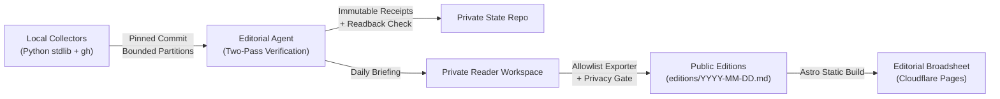

# Daily Brief

> An open-source, zero-dependency news acquisition engine, editorial contract (**SpecPack v0.2**), and Swiss broadsheet publication for daily AI, security, and open-source developer tools.

**Live site:** [popcornnn.xyz](https://popcornnn.xyz) · [Archive](https://popcornnn.xyz/archive/) · [RSS](https://popcornnn.xyz/rss.xml) · [JSON Feed](https://popcornnn.xyz/feed.json) · [llms.txt](https://popcornnn.xyz/llms.txt)

Most AI brief tools break in the same predictable ways: they trust `sitemap.xml` `<lastmod>` dates, silently overflow context when a repo has 400 commits, mistake feed timeouts for quiet news days, or overfit to a single thumbs-up. **Daily Brief** packages the boring engineering guardrails that fix those failures alongside the editorial website where the finished issues live.



---

## Repository Layout

| Path | Purpose |
| --- | --- |
| [`collectors/`](collectors/) | Zero-dependency Python collectors (`tech-ai`, `open-source`), lossless partitioner & immutable receipt validator (`brief_workflow.py`), and feedback ledger helper (`brief_feedback.py`) |
| [`specpack/`](specpack/) | **SpecPack v0.2** recipe (`spec.md` core invariants, `decisions.md` traps/dead ends, `SKILL.md` personalisation interview, sanitized prompt templates, `eval.md`) |
| [`publisher/`](publisher/) | Deterministic Markdown exporter, Notion file-image localizer, optional counter-only provenance enricher, and zero-tolerance `privacy_gate.py` |
| [`editions/`](editions/) | Public daily editions (`YYYY-MM-DD.md`) and `index.json` |
| [`site/`](site/) | Light-mode editorial website built with Astro 5, React 19, Tailwind CSS v4, and self-hosted variable typography (`Fraunces`, `Inter`, `JetBrains Mono`) |
| [`tests/`](tests/) | Offline unit test suites covering workflow invariants, feedback provenance, execution audits, and publication sanitization |

---

## Quick Start

### 1. Run the Verification Suite

```sh
python3 -m unittest discover -s tests -v
python3 publisher/privacy_gate.py .
```

### 2. Run the Website Locally

```sh
pnpm --dir site install
pnpm --dir site dev
```

Build the static production bundle (with `/rss.xml`, `/feed.json`, `/llms.txt`, and raw `/editions/*.md`):

```sh
pnpm --dir site build
```

### 3. Deploy to Cloudflare Pages

1. Connect `Popcornnnnnnnn/daily-brief` in **Cloudflare Dashboard → Workers & Pages → Create application → Pages → Import an existing Git repository**.
2. Configure the build settings:
   - **Production branch:** `main`
   - **Root directory:** `site`
   - **Build command:** `pnpm build`
   - **Build output directory:** `dist`
   - **Environment variables:** `NODE_VERSION=22`, `PNPM_VERSION=12`, `SITE_URL=https://<your-domain>`
3. Add your custom domain in **Custom domains** — Cloudflare automatically provisions DNS + TLS and serves `_headers` cache/security rules.

### 4. Run Your Own Collector

Copy the example configs (keeping real `config.json` and `state/` untracked via `.gitignore`):

```sh
cp collectors/tech-ai/config.example.json collectors/tech-ai/config.json
cp collectors/open-source/config.example.json collectors/open-source/config.json
python3 collectors/tech-ai/collector.py collect
python3 collectors/open-source/collector.py collect
```

Environment variables supported by the collectors:
- `DAILY_BRIEF_BRIDGE_REPO`: path to your private Git state repo checkout
- `DAILY_BRIEF_BRIDGE_LOCK`: path to the shared bridge lockfile
- `GH_BIN`: path to the GitHub CLI binary (`gh`)

---

## Rebuild for Your Own Workflow (SpecPack v0.2)

Don't want Notion or our exact schedule? Hand [`specpack/`](specpack/) to your coding agent:

- [`specpack/spec.md`](specpack/spec.md) locks the 9 core reliability and privacy invariants.
- [`specpack/decisions.md`](specpack/decisions.md) shares dead ends (like `sitemap.xml` `<lastmod>` traps and expiring S3 image URLs).
- [`specpack/SKILL.md`](specpack/SKILL.md) walks through a short taste interview so your agent adapts the surface (Obsidian, Slack, Email, CLI, or Web) to your habits.

---

## License

MIT — see [LICENSE](LICENSE).
