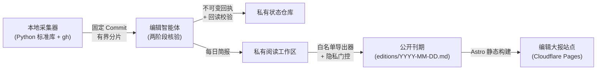

# Daily Brief

[English](README.md) · **简体中文**

> 一个开源、零外部依赖的新闻采集引擎、编辑契约（**SpecPack v0.2**），以及面向每日 AI、安全与开源开发者工具的瑞士大报风格出版物。

**线上站点：** [brief.popcornnn.xyz](https://brief.popcornnn.xyz) · [归档](https://brief.popcornnn.xyz/archive/) · [RSS](https://brief.popcornnn.xyz/rss.xml) · [JSON Feed](https://brief.popcornnn.xyz/feed.json) · [llms.txt](https://brief.popcornnn.xyz/llms.txt)

大多数 AI 简报工具都会以同样的可预测方式失效：它们轻信 `sitemap.xml` 的 `<lastmod>` 日期、在仓库有 400 次提交时悄然撑爆上下文、把 Feed 超时误判为当天没有新闻，或者对单次点赞过度拟合。**Daily Brief** 将解决这些故障的工程护栏连同最终刊期发布的编辑网站一起打包开源。



---

## 仓库结构

| 路径 | 用途 |
| --- | --- |
| [`collectors/`](collectors/) | 零依赖 Python 采集器（`tech-ai`、`open-source`）、无损分片器与不可变回执校验器（`brief_workflow.py`）以及反馈台账辅助工具（`brief_feedback.py`） |
| [`specpack/`](specpack/) | **SpecPack v0.2** 配方（`spec.md` 核心不变量、`decisions.md` 踩坑与死胡同、`SKILL.md` 个性化访谈、脱敏提示词模板与 `eval.md`） |
| [`publisher/`](publisher/) | 确定性 Markdown 导出器、Notion 附件图片本地化工具、可选纯计数来源增强器以及零容忍 [`privacy_gate.py`](publisher/privacy_gate.py) |
| [`editions/`](editions/) | 公开每日刊期（`YYYY-MM-DD.md`）与 `index.json` |
| [`site/`](site/) | 基于 Astro 5、React 19、Tailwind CSS v4 与本地托管可变字体（`Fraunces`、`Inter`、`JetBrains Mono`）构建的浅色编辑网站 |
| [`tests/`](tests/) | 离线单元测试套件，覆盖工作流不变量、反馈溯源、执行审计与发布脱敏 |

---

## 快速开始

### 1. 运行验证套件

```sh
python3 -m unittest discover -s tests -v
python3 publisher/privacy_gate.py .
```

### 2. 本地运行网站

```sh
pnpm --dir site install
pnpm --dir site dev
```

构建静态生产产物（包含 `/rss.xml`、`/feed.json`、`/llms.txt` 与原始 `/editions/*.md`）：

```sh
pnpm --dir site build
```

### 3. 部署到 Cloudflare Pages

1. 在 **Cloudflare Dashboard → Workers & Pages → Create application → Pages → Import an existing Git repository** 中连接 `Popcornnnnnnnn/daily-brief`。
2. 配置构建设置：
   - **Production branch:** `main`
   - **Root directory:** `site`
   - **Build command:** `pnpm build`
   - **Build output directory:** `dist`
   - **Environment variables:** `NODE_VERSION=22`、`PNPM_VERSION=12`、`SITE_URL=https://<your-domain>`
3. 在 **Custom domains** 中添加你的自定义域名——Cloudflare 会自动配置 DNS 与 TLS，并应用 `_headers` 缓存与安全规则。

### 4. 运行自己的采集器

复制示例配置文件（通过 `.gitignore` 确保真实的 `config.json` 与 `state/` 不会被提交）：

```sh
cp collectors/tech-ai/config.example.json collectors/tech-ai/config.json
cp collectors/open-source/config.example.json collectors/open-source/config.json
python3 collectors/tech-ai/collector.py collect
python3 collectors/open-source/collector.py collect
```

采集器支持的环境变量：
- `DAILY_BRIEF_BRIDGE_REPO`：私有 Git 状态仓库的本地检出路径
- `DAILY_BRIEF_BRIDGE_LOCK`：共享桥接锁文件路径
- `GH_BIN`：GitHub CLI（`gh`）可执行文件路径

---

## 为你的工作流重建（SpecPack v0.2）

不想使用 Notion 或我们这套固定排期？可以把 [`specpack/`](specpack/) 直接交给你的编程智能体：

- [`specpack/spec.md`](specpack/spec.md) 锁定了 9 条核心可靠性与隐私不变量。
- [`specpack/decisions.md`](specpack/decisions.md) 分享了踩坑记录（例如 `sitemap.xml` `<lastmod>` 陷阱和会过期的 S3 图片链接）。
- [`specpack/SKILL.md`](specpack/SKILL.md) 会引导完成简短的品味访谈，让智能体把输出载体（Obsidian、Slack、邮件、CLI 或 Web）适配成符合你习惯的形式。

---

## 许可证

MIT — 详见 [LICENSE](LICENSE)。
